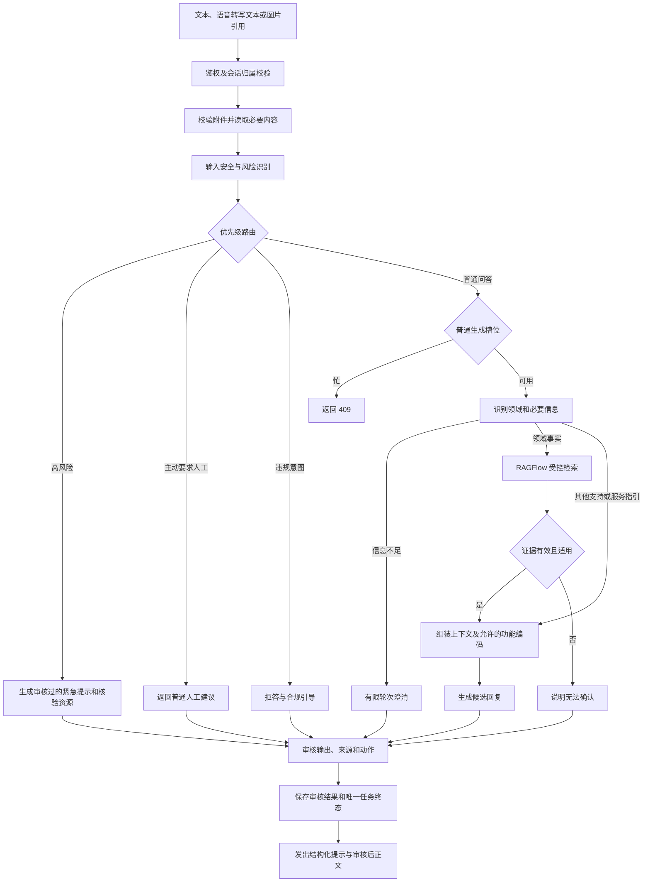

# AI 咨询工作流

本文描述 AI 咨询的目标工作流。咨询专用图与模板聊天图分别运行。已实现范围和验收缺口见 [研发交接](zh-CN/04-handoff.md)，接口、事件和字段以 [08 联调协议](zh-CN/08-miniprogram-mvp-api.md) 为准。

调用关系：小程序 → 平台业务服务 → AI 咨询接口 → LangGraph → 受控 RAGFlow 检索。平台管理登录、会话编号、历史、附件和人工咨询；AI 服务负责编排、作答、风险识别和提示。

## 1. 每轮主流程

图为逻辑顺序，不是可直接运行的 `StateGraph`。已识别的风险不能因常规检索、重写或审核服务故障而降级；使用已预审的风险模板作为兜底。涉及多工具时先确定必要工具集合，汇合后才生成，避免绕过必需检索。

## 2. 风险、拒答和人工建议

风险检查在普通槽位之前。普通生成占用槽位时可返回 `409 GENERATION_IN_PROGRESS`；平台不能以忙为由直接跳过新消息的风险检查。命中高风险时优先返回 `human_handoff_required`、审核提示和核验过的资源，旧任务停止迟到的普通输出。已识别风险提示不随普通停止生成而撤回。

情绪支持与风险识别由受控节点执行，考虑否定、历史和引用；关键词不是诊断。分类服务不可用时不能默认低风险。主动要求人工或连续两次无法作答时，仅返回普通 `human_handoff_suggested`；平台决定是否展示和如何承接。AI 不创建工单、不通知人员、不查询人工进度、不执行 24 小时提醒。

无法作答计数按会话和已完成轮次幂等更新：有效作答清零，无可用依据或超范围的已完成轮次累加；澄清、违规拒答、风险提示、取消、重放与系统繁忙不累加。依赖故障按普通错误返回，不冒充无依据。重新生成属于原轮次，不能把同一轮失败重复计数。仅当新版本成功时替换该轮结果。

## 3. 检索、附件和引用

知识、政策、流程中的事实回答须检索已发布、适用的资料；开放网页搜索不作为无命中回退。审核引用是否支持对应结论，检查地区、有效期和版本。医学科普提示和高风险资源由客户专业人员审定。功能推荐使用平台允许的 `action_code`，页面映射和实际办理由平台负责。

录音、转写与授权由平台负责，AI 只收最终文字。首期图片由平台先上传和校验归属，再传 `file_id` 与短期 HTTPS 只读地址或 Base64；AI 校验允许域名、大小、实际媒体类型与超时，不接收任意链接，也不在 checkpoint 或日志保留读取地址和 Base64。无文字但有图片时可澄清；图片不可读取时明确报错。后续需要再看旧图时，平台重新授权提供。

## 4. 结果、取消和重新生成

首期先审核完整候选，再分段发送正文。风险提示以结构化事件发出，任务查询也能返回同样的风险数据，供平台恢复展示；没有正文时不编造答案。若任务或风险结果无法登记，按接口合同返回失败及可安全展示的风险提示，不伪造已登记状态。

审核结果提交后生成状态为 `completed`；此前取消才形成 `cancelled`，之后停止只影响指定订阅传输。网络重试复用同一幂等键，断线查询原任务，不重发问题。最新普通答案允许重新生成：从原问题和作答前上下文开始，保留用户消息，重新走风险检查与审核；成功才替换续聊答案，失败或取消保留旧版。涉及图片需重新提供原附件读取方式。

平台 MySQL 保存页面历史、用户消息及完整审核结果。AI PostgreSQL 保存任务、事件和续聊所需的近期有效轮次，LangGraph checkpoint 只记录工作流结果标记。两边通过稳定 ID 对齐。平台页面、FAQ、反馈、人工和运营由平台承接。

## 5. 配套文档

- [总体设计](zh-CN/03-ai-consultation-design.md)
- [首轮联调协议](zh-CN/08-miniprogram-mvp-api.md)
- [RAGFlow 方案](zh-CN/06-ragflow-integration.md)
- [材料与验收](zh-CN/07-materials-and-acceptance.md)
