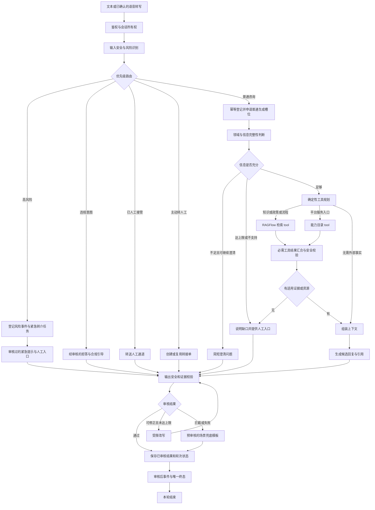

# AI 咨询工作流

更新：2026-11-02；代码基线：`5ab5e94`。本文件为待开发设计，当前 Python 主图仍只有 `chat` / `tool_call`。原草图中的情绪、意图、工具与输出检查保留，补齐业务闭环。

调用关系：小程序 → 平台业务服务/BFF → AI 咨询接口 → LangGraph → 受控 RAGFlow 检索工具。用户通过小程序使用服务，平台负责登录身份；本服务验证调用方、用户权限并处理咨询。

## 1. 每轮主流程

图是逻辑顺序，不能直接视为可执行的 `StateGraph` 定义。并行工具先声明本轮必需任务集合，再 join 一次；不得同时保留绕过检索结果的直达边。所有结束路径由一个 `finalize_turn` 收口。

## 2. 路由、澄清与风险

路由优先级：高风险 → 已人工接管 → 主动转人工 → AI 违规拒答 → 常规意图。内容拒答约束 AI 生成，不能吞掉同一条消息中的明确人工请求。高风险不等待常规检索、工具超时或用户确认；之后发现可信新增风险也要终止普通生成并升级。

风险分流独立于普通生成槽位：即使会话已有生成任务，也先检查新消息的风险。紧急消息抢占普通任务、幂等登记风险与转介任务；旧任务在落库/继续发送前检查会话风险版本，停止迟到输出。鉴权和必要的反滥用保护仍执行，不能为绕过并发限制开放未授权接口。

情绪支持与风险识别是受控节点，不交给模型自由决定是否调用。规则与结构化分类结合，考虑否定、历史和引用；关键词可触发保守处理，但不能作为唯一诊断。分类服务失败不得默认为低风险。毒品科普、预防与求助不能仅因出现敏感名词被一律拒绝。

澄清只问完成回答所必需的信息，设置轮数上限；下一条消息重新经过鉴权和风险识别，不在 HTTP 请求中等待用户。`ask_human()` 仅是图暂停机制，向用户澄清、转工作人员、危机通知分别实现。

知识、政策、流程的事实问题强制检索已发布且适用的资料。问候、基础情绪支持可无需检索，但仍经安全审核。首版不启用开放 WebSearch 作为无命中回退。

## 3. 答案、引用与平台功能

来源取真实文档/片段 ID，审核时验证引用存在、地区/有效期适用且能够支持回答。政策名称、文号（如有）、原文出处由元数据提供；流程的条件、材料、时限与步骤来自发布版本。检索相似度不能当作答案正确率。

功能卡片输出允许列表中的 `action_code`，由小程序映射页面；追问、来源、卡片与正文一起审核。模型不能编造页面路径、工单成功状态或业务办理结果。医学高风险走经专业审核的紧急引导，其他医学类知识附客户确认的提示语。

## 4. 无答案计数与转人工

`unanswered_streak` 按服务端会话顺序原子更新，每个已完成轮次最多加一次。建议：有效作答清零；无证据、超出范围、服务失败无法回答加一；澄清、违规拒答、高风险处理、业务完成前取消与重复请求不加。计数只随业务终态提交，审核结果已经提交后再停止传输不回滚计数；失败事件和任务查询也返回计数及人工入口。具体统计口径需产品确认。

连续两次无法作答必须提供人工入口，用户确认才创建普通转接单；用户主动要求则直接创建；高风险自动创建紧急转介。人工单包含原因、会话关联、上下文摘要、受理人/状态、回复及时间，幂等键保证重试不重复。

会话模式为 `ai → handoff_pending → human_active → awaiting_resume → ai`，与工单投递/受理状态分开。人工关闭后需授权恢复 AI；投递失败保留可见重试状态，不能永久卡住或悄悄恢复。详见接口合同的恢复/重试规则。人工接管后仍做风险监测，避免双方抢答。普通单 24 小时未受理提醒由持久后台任务触发，不依赖聊天请求、进程内定时器或 `asyncio` 睡眠。高风险采用客户指定的紧急响应和升级时限，不能等待普通单的 24 小时规则。

## 5. 高风险可靠处置

先在同一业务事务中保存风险标记、风险证据关联与 outbox 任务，再发审核后的紧急提示。worker 按幂等键创建转介工单并通知工作人员，保存外部单号、投递状态、受理确认及处置状态；失败有重试、告警和补偿路径。

紧急提示不等待外部工单网络调用。数据库不可用也应展示预审核的最小提示，准确说明转介提交状态，并使用独立可用的运维告警渠道报障；不能声称工作人员已收到。普通停止生成或断线不能撤销已登记的风险处置任务。

紧急资源清单、地区/服务时间、服务对象以及未成年人通知策略由客户核验配置。年龄未知不能推断成年，通知对象不能由模型任意选择。业务记录加密保存、展示按权限脱敏；追踪日志避免原文外溢。

## 6. 流式、取消、存储与运营

首版方案：完整候选生成 → 审核 → 分段发送已审核正文；前面发送受控进度事件。这满足分段展示但有审核前置延迟，首字时延需与产品确认。若要求低延迟分段生成，应另验收逐段审核、跨段风险和不可撤回内容的边界。

停止使用独立取消接口和 `generation_id`。审核答案落库时原子提交业务 `completed` 与计数；之前取消才形成 `cancelled`，之后停止只记录 `delivery_status=aborted`，不修改完成终态。断开连接不等于取消完成。普通任务每会话初期仅一个，紧急风险分流不受其槽位阻塞；`client_message_id` 防重复提交，断线可查询状态，不重放工单副作用。

业务消息表用于会话分页、来源、反馈、风险标记、删除状态与加密存储，checkpoint 用于执行恢复。高风险不可由用户删除，留存依据、期限和解除权限待客户确认；普通删除覆盖消息、checkpoint、派生缓存/记忆以及后台写入，不能只删 `session` 表。

FAQ、关键词联想、反馈和运营汇总提供独立接口。反馈关联回答 ID 与知识发布版本；功能卡片点击、到达、办理完成由平台回传，不能将卡片生成量当作业务转化量。

## 7. 对原草图的修订与配套文档

修复意图清晰分支同时进入 ToolPlanner 和 ToolJoin 的绕行；补齐澄清退出、主动人工、两次无法回答、可靠工单、审核后流式、停止生成、引用、功能卡片、留存和运营闭环。人工转介根据条件触发，不再是危机节点的可选旁路。

- [总体设计](zh-CN/03-ai-consultation-design.md)：职责、数据与开发落点。
- [接口合同](zh-CN/05-api-contract.md)：流事件、取消、卡片和工单约定。
- [RAGFlow 方案](zh-CN/06-ragflow-integration.md)：版本、检索、引用和知识发布。
- [材料与验收](zh-CN/07-materials-and-acceptance.md)：需求覆盖、双方输入及验收。
- [实施顺序](zh-CN/04-handoff.md)：分阶段交付与阻塞项。
