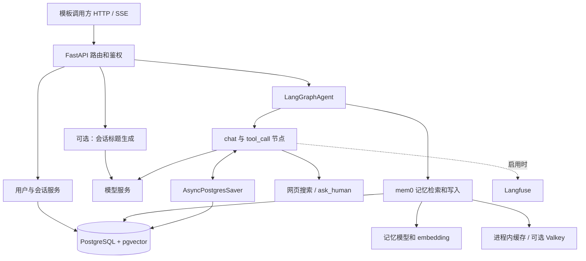
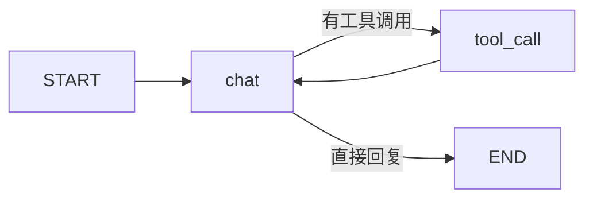

# 01：代码导读与请求流程

本文导读 fork 的基础模板代码（基线 `5ab5e94`）。新增的咨询业务代码和进度见 [研发交接](04-handoff.md)，业务路径见 [工作流设计](../workflow.md)。

系统定位已调整为**供小程序等业务服务调用的 AI 咨询后端**。终端登录、悬浮窗、录音授权和页面展示由小程序及其业务服务负责；本服务负责咨询、检索、来源、安全策略、会话和协同处置接口。免注册匿名入口、匿名身份和可逆 PII 占位符还原不再作为本期功能目标，敏感信息保护仍需遵守实际业务要求。

## 1. 按这个顺序看代码

以下链接都指向本仓库实际文件。原有 `AGENTS.md` 中部分目录说明已过时，例如数据库服务实际位于 `app/services/database.py`，模型服务位于 `app/services/llm/`。

| 顺序 | 文件 | 阅读重点 |
| --- | --- | --- |
| 1 | [app/main.py](../../app/main.py) | 应用入口、启动预热、中间件、健康检查 |
| 2 | [app/api/v1/api.py](../../app/api/v1/api.py) | API 前缀与路由组织 |
| 3 | [app/api/v1/auth.py](../../app/api/v1/auth.py) | 用户 token 和会话 token 的不同用途 |
| 4 | [app/api/v1/chatbot.py](../../app/api/v1/chatbot.py) | 聊天、流式输出、历史读取、清空 |
| 5 | [app/schemas/chat.py](../../app/schemas/chat.py)、[graph.py](../../app/schemas/graph.py) | API 消息和图状态的数据结构 |
| 6 | [app/core/langgraph/graph.py](../../app/core/langgraph/graph.py) | 最核心的工作流、持久化、中断恢复 |
| 7 | [LLM service](../../app/services/llm/service.py)、[registry](../../app/services/llm/registry.py) | 多 provider 模型工厂、注册、tenacity 重试、回退 |
| 8 | [memory.py](../../app/services/memory.py)、[session_naming.py](../../app/services/session_naming.py) | 最新用户轮次记忆提取、标题生成及其独立配置 |
| 9 | [config.py](../../app/core/config.py)、[database.py](../../app/services/database.py) | 配置加载、业务数据库 |
| 10 | [observability.py](../../app/core/observability.py)、[evals](../../evals/main.py) | 追踪和评估 |
| 11 | [tasks.py](../../app/utils/tasks.py)、[memory_capture.md](../../app/core/prompts/memory_capture.md) | 进程内后台任务、记忆事实提取提示词 |

## 2. 整体分工

FastAPI 管接口，LangGraph 管执行顺序，LLM 服务管如何调用模型。PostgreSQL 同时承载业务表、图状态和向量记忆，但三类数据的管理方式不同。

这是当前模板的结构，尚未包含 RAGFlow。目标调用链是“小程序 → 小程序业务服务 → 本 AI 咨询 API → LangGraph → 受控 RAGFlow 检索工具”。RAGFlow 管知识解析、索引与检索；本服务继续管会话、风险路由、回复审核和人工转接，不把服务端凭据交给小程序。

当前没有小程序身份接入、结构化引用、功能卡片、转人工工单、风险记录、停止生成、FAQ 或反馈接口。这些均需要围绕业务契约新增；模板已有的账号接口仅能用于原框架开发联调。

## 3. 应用启动时发生什么

1. 导入路由及服务模块时创建全局 `settings`、`database_service`、`llm_service` 和 `agent` 等对象；部分配置错误会在导入阶段出现。
2. `lifespan()` 初始化缓存，预热 LangGraph 和 mem0。
3. `create_graph()` 建立 PostgreSQL 连接池，并调用 `AsyncPostgresSaver.setup()` 准备 checkpoint 表。
4. 业务表需要另外执行 Alembic 迁移；创建图不会自动创建 `user`、`session` 等业务表。

启动预热失败会被记录，HTTP 服务仍可能启动。因此，看到端口可用不等于聊天可用。`/health` 检查数据库能否执行查询，但不验证模型、业务表迁移或整个聊天流程；`/api/v1/health` 只是静态健康响应。

## 4. 一次普通聊天请求

以 `POST /api/v1/chatbot/chat` 为例：

1. `ChatRequest` 校验消息列表非空、单条内容 1～3000 字符，并检查 script 标签、空字节等。
2. `get_current_session()` 从 Bearer token 中取 `sub`，查询并验证会话，获得 `session.id`、`user_id` 和 `username`。
3. 如启用自动命名，`maybe_name_session()` 先将首条用户消息的前 40 个字符作为临时标题写入数据库，再后台调用模型生成标题。
4. `get_response()` 并发读取该会话的 checkpoint 和检索该用户的长期记忆。记忆查询使用本次最后一条消息的内容。
5. 若图处于等待输入状态，用 `Command(resume=...)` 恢复；否则将消息和检索出的记忆作为图输入。
6. `chat` 节点装配系统提示词、用户名、长期记忆以及经过 token 裁剪的消息，调用模型。
7. 模型要求调用工具时进入 `tool_call`，工具结果追加回状态，再回到 `chat`。
8. 执行完成后通过 `create_background_task()` 调用 `memory_service.add()`。新版本只将最新一条用户消息交给 mem0 提取持久事实，不再把助手回复或整段历史作为记忆输入；事实提取规则来自 `memory_capture.md`。
9. 返回状态中筛选出的用户和助手消息，**普通响应通常包含累积历史，而不只是最后一句回复**。

前端继续同一会话时，宜只发送本轮新增的用户消息。因为服务端已有 checkpoint，而请求消息没有稳定的 ID，反复发送全部历史可能造成重复追加。

本项目的实际调用方将是业务服务。新咨询接口宜接收单条用户消息和稳定的客户端消息 ID，由服务端加载历史并做幂等处理；不要要求小程序拼装整段历史或自行填写受信的系统消息。当前 schema 仍允许 `system`、`assistant` 角色，尚未按这一目标收敛。

## 5. LangGraph 的关键概念

当前业务路由意图如下：

- **State**：`GraphState` 只有 `messages` 和 `long_term_memory` 两个字段。
- **Reducer**：`messages` 使用 `add_messages` 合并新旧消息；它并非每次直接覆盖整个历史。
- **Node**：`_chat()`、`_tool_call()` 是处理状态的函数。
- **Command**：同时表达状态更新和后续节点，例如 `Command(update={...}, goto="tool_call")`。
- **CompiledStateGraph**：`compile()` 得到的可执行图，普通调用用 `ainvoke()`，流式调用用 `astream()`。
- **thread_id**：此处取 `session.id`，决定 checkpoint 读写属于哪一场会话。它不等于用户 ID。
- **Interrupt**：`ask_human()` 暂停图并等待下一次输入；这是执行机制，尚不包含咨询师接管、告警派单等业务能力。

源码还调用了 `set_finish_point("chat")`，会建立结束边。后续插入筛查或输出安全节点时，要一起调整现有 `Command.goto`、入口及结束边，并验证每条路径实际经过安全节点；只写 `add_node()` 不会让节点自动执行。

默认工具仍只有网页搜索和 `ask_human`。接入 RAGFlow 时，需要新增检索服务适配和工具定义，并由工作流保证知识、政策、流程回答在有有效证据时生成；不能仅靠提示词期待模型每次主动选择检索。`ask_human` 也不能直接当作 24 小时受理提醒和工作人员通知机制。

## 6. 数据到底存在哪里

| 数据 | 位置与管理者 | 接手时的含义 |
| --- | --- | --- |
| 邮箱、密码哈希、用户名 | `user` 表，SQLModel / Alembic | 当前账号体系可以关联身份 |
| 会话 ID、所属用户、标题、用户名副本 | `session` 表，SQLModel / Alembic | 标题和用户名也可能包含 PII |
| 消息、图状态、中断状态 | `checkpoint_*` 等表，LangGraph saver | 不需要自建消息表就能续聊；图输入也可能被持久化 |
| 用户长期记忆、向量 | mem0 / pgvector；默认 collection 为 `longterm_memory` | 默认按用户隔离，可跨会话检索；新版仅向 mem0 发送最新用户消息 |
| 记忆查询缓存 | 进程内缓存，或选配 Valkey/Redis | 当前主要缓存记忆搜索结果，非完整聊天答案 |
| 追踪、应用日志、评估报告 | Langfuse、`logs/`、`evals/reports/` | 也属于数据保留与删除边界 |

`app/models/thread.py` 虽定义了 `thread` 表，但当前聊天代码实际按 `session.id` 访问 LangGraph checkpoint；不要把它误认为正在使用的消息存储表。

`DELETE /chatbot/messages` 只清理配置中的三张 checkpoint 数据表；`DELETE /auth/session/{id}` 只删除业务会话记录。二者都不是“删除用户全部数据”，不会联动清理 mem0、缓存、日志或 Langfuse。

当前会话表没有消息数、摘要、风险等级、删除状态和保留策略等需求字段，也没有高风险记录、引用快照、工单或反馈表。Checkpoint 用于图恢复，不能独自承担可审计的业务消息记录、风险保留和运营统计。后续需区分“对用户隐藏”“禁止删除的受控留存”“到期清理”，具体期限及高风险留存依据由客户确认。

`create_background_task()` 已用集合保存强引用，解决任务被提前回收的问题；它仍是当前 Python 进程中的任务，重启或崩溃后不能保证送达，不具备持久重试和去重语义。人工工单、24 小时提醒、风险升级通知应由有持久状态的业务任务或 outbox 驱动。

## 7. 接口和 token 对照

默认公共前缀为 `/api/v1`。

| 方法和路径 | 请求 / 鉴权 | 作用 |
| --- | --- | --- |
| `POST /auth/register` | JSON 邮箱、密码、可选 username | 注册，返回 `token.access_token`（用户 token） |
| `POST /auth/login` | form 表单 email/password | 登录，返回 `access_token`（用户 token） |
| `POST /auth/session` | 用户 token，无请求体 | 创建会话，返回 `token.access_token`（会话 token） |
| `GET /auth/sessions` | 用户 token | 列出该用户会话，并返回各会话 token |
| `PATCH /auth/session/{id}/name` | 会话 token，form 字段 name | 修改当前会话标题 |
| `DELETE /auth/session/{id}` | 会话 token | 删除当前业务会话记录 |
| `POST /chatbot/chat` | 会话 token，JSON messages | 普通对话 |
| `POST /chatbot/chat/stream` | 会话 token，JSON messages | SSE 流式对话 |
| `GET /chatbot/messages` | 会话 token | 当前会话历史 |
| `DELETE /chatbot/messages` | 会话 token | 清理当前会话 checkpoint 数据 |

两类 token 使用同一套签名工具，`sub` 分别为用户 ID 字符串和会话 UUID，由接口依赖区分用途；目前没有显式的 token 类型 claim。业务集成时需要确定调用方鉴权、可信终端用户标识映射，以及每次会话访问的归属校验。不能信任小程序自行提交的 `user_id`，也不能用一个共享用户账号承载所有终端用户的会话和记忆。

SSE 每个事件形如 `data: {"content":"...","done":false,"request_id":"..."}`，最后 `done=true`。当前直接输出所有匹配的模型文本增量，没有按节点标识只保留最终回答；新增筛查节点后，内部分类文本也可能混入流中。增加输出过滤节点时需一起改造发送路径，明确审核后输出的单位、结构化来源与功能卡片事件、取消状态和错误事件。

断开 SSE 连接不等于已经实现“停止生成”：当前没有 run ID、取消接口或明确的取消持久化状态。后续需使生成任务、存储状态和客户端显示保持一致，并保证取消不会抹掉已经触发的风险处置。

## 8. 新版模型接入怎么读

`registry.py` 已从直接构造 `ChatOpenAI` 改为 `_build_llm()` 调用 LangChain `init_chat_model()`。配置分两层：

| 层次 | 作用 |
| --- | --- |
| `LLM_CONFIGS` | 注册名 `name`、真实模型标识 `model`、provider 参数 `kwargs` |
| `LLMS` | 导入模块时按配置预创建的模型实例 |
| `LLMRegistry.get(name)` | 按注册名取实例；额外传参时构造一次性模型 |
| `DEFAULT_LLM_MODEL` | 选择注册名；不会自动增加注册项，未知名称在默认服务初始化路径会退回首项 |

`model` 可为现有裸 `gpt-*` 名称或 `provider:model`。`pyproject.toml` 已提供 `anthropic`、`ollama`、`google-genai` 等可选依赖；选定服务商后只安装需要的 extra。默认注册表仍是四个 GPT 配置，并没有因为框架支持 provider 工厂就自动接入团队的实际模型。

显式在配置 `kwargs` 或一次性调用参数中设置 OpenAI 兼容的 `base_url` / `openai_api_base` 时，工厂要求同时传入该端点自己的 `api_key` / `openai_api_key`，避免把默认密钥送到另一地址。此检查针对显式参数；不要把它当作对全部 SDK 环境变量和端点组合的完整配置校验。实际端点、凭据和回退名单仍需团队明确。

`LLMService` 默认路径保留工具绑定并在失败时循环回退；指定模型、结构化输出或额外参数的路径使用局部实例。Tenacity 的指数退避目前只匹配 OpenAI 的限流、超时和 API 错误；其他 provider 错误可触发模型回退，尚不享有相同的逐模型退避策略。`TypeError`、`AttributeError`、`KeyError` 会直接上抛，避免把程序错误当供应商故障吞掉。

此外，mem0 的记忆模型与 embedding 配置仍独立使用 OpenAI provider，标题生成也显式选择注册名 `gpt-5.4-nano`。更换主聊天 provider 不会自动更换这两条调用。记忆并非业务 RAG：mem0 提取用户事实，RAGFlow 检索经审核的知识、政策与办理流程；二者的数据来源和更新规则要分开。

## 9. 代码与规范之间的差异

这些是本地源码可确认的接手事项，不等于已经修复：

| 项目 | 实际实现 |
| --- | --- |
| 配置 | `Settings` 是普通 Python 类，使用 `os.getenv`，不是 Pydantic Settings |
| 数据库异步 | 业务方法虽写成 `async def`，内部仍使用同步 `Session` 和 `create_engine`；checkpoint 则用异步 psycopg |
| 限流 | 聊天、注册、登录等已有显式装饰器；部分会话接口和 v1 健康接口没有，需逐项补齐 |
| 重试 | LLM 使用 tenacity；工具节点使用 LangGraph `RetryPolicy`，与“所有重试用 tenacity”的规范存在差异 |
| 日志 | 使用 structlog，但仍有 `logger.error`，且部分字段包含邮箱、查询原文、标题或校验输入 |
| 追踪 | 图执行可配置 Langfuse callback；标题、记忆、embedding、评估等调用的覆盖需单独核验 |
| 模型切换 | 已支持 `init_chat_model` 多 provider 工厂，注册表仍由 `LLM_CONFIGS` 显式定义；provider 依赖、凭据和回退范围需配置 |
| 单元测试 | 当前基线没有现成的 `tests/`；`evals/` 是依赖模型和 Langfuse 的质量评估，不能代替接口与隔离测试 |

用户已反馈同事跑通模板；这说明模板基础链路在同事环境可用，不代表上述咨询业务、风险处置或服务端集成已经完成。继续开发时遵循 `AGENTS.md` 的新代码要求，把已有差异及新增业务各自拆成可验收任务。
