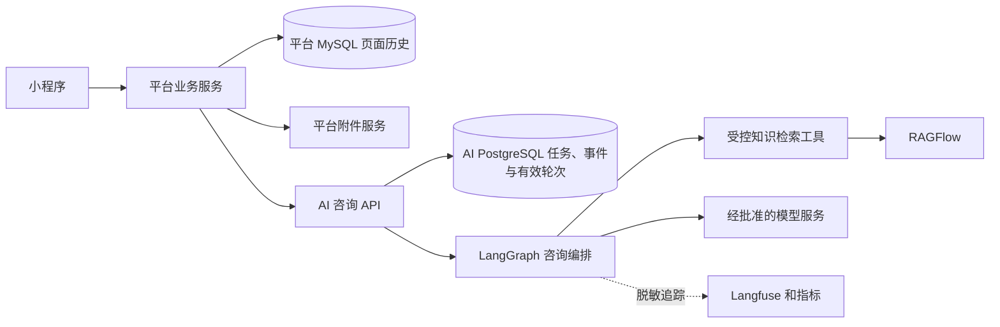

# 03：AI 咨询后端总体设计

本文记录首期设计。已实现范围及联调缺口见 [研发交接](04-handoff.md)，接口字段以 [08 首轮联调协议](08-miniprogram-mvp-api.md) 为准。

## 1. 范围与职责

项目向平台提供戒毒康复知识、政策、流程问答、情绪支持与风险提示。平台持有用户登录态及页面业务，本服务不承担免登录匿名会话。

| 组件 | 首期责任 |
| --- | --- |
| 小程序与平台 | 登录、窗口、麦克风授权和语音转写、图片上传、会话编号、MySQL 历史、页面跳转、人工入口与接续 |
| AI 咨询后端 | 验证可信主体与会话作用域、续聊编排、受控检索、引用、安全审核、流式交付、停止与重新生成 |
| RAGFlow | 已审核知识的解析、索引、检索；证据是否适用与如何输出由 AI 工作流判断 |
| 客户专业负责人 | 审核知识与政策、医疗边界提示、风险识别准则、紧急资源和数据保留要求 |

FAQ、关键词联想、反馈、运营后台、人工工单、人员通知和 24 小时提醒属于客户整体需求，首期不建设相应 AI 接口。平台确认其产品归属和实施方式；AI 提供审核答案、来源、功能编码和必要的人工提示。

## 2. 系统关系

平台验证登录及会话归属并传递可信调用方、用户上下文。AI 以应用、租户、主体和平台会话 ID 隔离状态，不信任正文里的 `user_id`，不以共享账户承载所有用户。平台负责调用方认证与签名传递的具体约定，凭据不下发小程序。

## 3. 输入与知识

平台负责录音、转写和确认，AI 只接收最终文字，`input_type` 标为 `text` 或 `voice_transcript`。首期图片由平台上传、保存并校验归属，AI 接收 `file_id` 和短期 HTTPS 只读地址或 Base64；限制类型、大小、数量、域名、读取时间及重定向，不接收音频和文档。需要重新读取旧图片时，平台重新授权。读取凭据与 Base64 不持久化；图片发给模型前必须确认服务商和数据处理范围。

领域事实问题强制检索经审核、已发布且适用的资料。引用由实际文档和片段组成，验证适用地区、有效期和证据支撑；无合格证据时说明无法确认。开放网页搜索不作兜底。医学科普文案与紧急资源由专业负责人审核；平台功能推荐只使用批准的 `action_code`。

## 4. 人工建议与风险提示

| 信号 | AI 返回 | 平台责任 |
| --- | --- | --- |
| 明确要求人工或连续两次无法作答 | 普通 `human_handoff_suggested` | 决定是否展示普通人工入口、如何承接 |
| 高风险 | `human_handoff_required`、审核提示、核验资源 | 及时展示提示和转人工入口，实施后续处置 |

风险识别先于普通生成槽位，普通忙仍可返回 409；风险提示优先于常规检索和生成。AI 不派工单、不触发人员通知、不提供人工单状态，也不运行 24 小时提醒；风险提示不得被理解为已受理或已通知。

## 5. 状态与结果归属

| 存储/数据 | 责任 |
| --- | --- |
| 平台 MySQL 历史 | 会话编号、用户消息、图片 `file_id`、完整审核答案、风险提示及页面展示版本 |
| AI 续聊与 checkpoint | PostgreSQL 按可信主体和会话读取近期有效轮次；LangGraph checkpoint 只记录工作流结果标记 |
| AI 任务状态 | 生成 ID、幂等键、用户消息关联、答案版本、终态、审核结果和可重连所需事件 |
| 知识发布目录 | 审核版本、出处、地区、有效期、发布/撤回状态及允许使用的功能编码 |

双方以稳定消息和任务 ID 对齐，平台从任务查询补取完整结果并按 ID 去重。图恢复、AI 终态与平台历史属于不同提交边界，不能假定跨库原子写入。重新生成复用原用户轮次与作答前上下文，仅成功时切换答案版本；失败、取消不破坏原版本。已审核答案提交后，停止只影响指定流订阅。

咨询工作流的续聊上下文来自咨询 PostgreSQL。加密传输、敏感内容保护、访问控制及追踪脱敏仍适用。平台决定历史的删除与风险留存，双方还需确认 AI 侧任务和上下文数据的生命周期及删除方式。

## 6. 开发落点

| 位置 | 计划 |
| --- | --- |
| `app/api/v1/`、`app/schemas/` | 可信主体、消息与附件输入、查询/重生成、流事件、风险与普通人工提示 |
| `app/core/langgraph/` | 受控风险路由、领域检索、输出审核和结果收口 |
| `app/services/` | 任务幂等、续聊版本、附件读取与中止、知识目录适配 |
| `app/models/`、`alembic/` | AI 内部会话映射、任务/结果状态与必要迁移 |
| `app/services/llm/`、`app/core/prompts/` | 经批准的模型、图像输入能力、领域与安全文案 |
| `evals/`、后续测试 | 检索来源、会话隔离、图像失败、普通忙与高风险并发、重连、取消、重新生成 |

开发顺序见 [04](04-handoff.md)，执行逻辑见 [工作流](../workflow.md)，资料和验收见 [07](07-materials-and-acceptance.md)。
