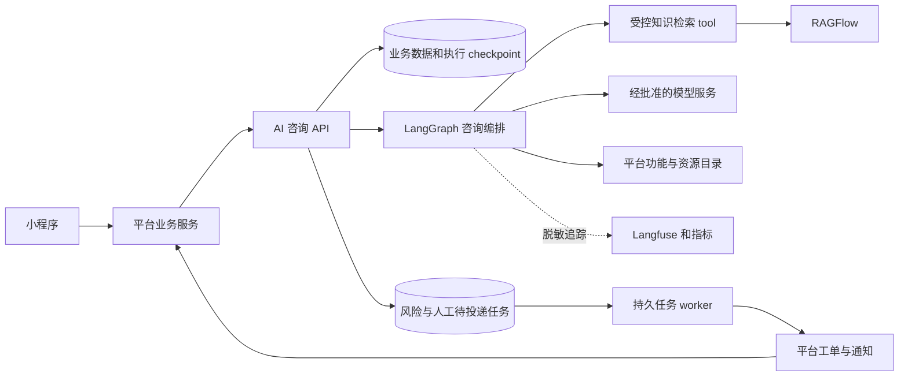

# 03：AI 咨询后端总体设计

更新：2026-11-02；基线：个人 fork 的 `5ab5e94`。下述为本次需求对应的待实施设计；已实现能力见 [代码导读](01-code-tour.md)。

## 1. 范围与职责

系统面向戒毒康复领域，供平台业务服务调用，为小程序提供知识、国家及江西政策、办理流程、多轮问答、情绪支持、功能推荐、转人工和风险升级能力。**免注册、匿名身份、可逆占位符加解密不在本次业务范围。** 数据加密、敏感信息脱敏展示、调用授权和受控审计仍是明确需求。

| 组件 | 责任 |
| --- | --- |
| 小程序 | 悬浮球/对话窗、麦克风授权、输入、审核后流式展示、停止按钮、来源展示、功能跳转及反馈 |
| 平台业务服务/BFF | 统一用户身份、调用本服务、页面能力目录、业务权限、人工工单/排班、通知与业务转化回传；哪些能力已有需对接确认 |
| AI 咨询后端 | 校验调用者和用户作用域、会话、编排、检索、回复与来源、风险/安全、人工状态同步、FAQ/反馈及质量数据 |
| RAGFlow | 经审核知识的解析、分块、索引和检索；不接管本服务的业务工单与主工作流 |
| 客户内容与专业负责人 | 审核知识/政策/流程、医学边界提示、风险分级与处置规则、资源清单和留存依据 |

语音识别/播报供应商与费用归属待确认。首版默认平台提供已确认的文本转写，本服务按文本请求处理；如平台需要由本服务代理 ASR/TTS，再增加受控接口与录音生命周期合同。不要把手机授权或语音识别成功归功于 LangGraph。

## 2. 系统关系

主流程见 [工作流](../workflow.md)。RAGFlow 作为 tool 接入是合理路线，但领域事实问题应由路由规则强制检索，不依赖模型是否愿意调用工具。情绪/风险判断和最终审核同样是必经节点。首版关闭开放网页搜索在业务路由中的默认可用性。

## 3. 可信身份和用户数据边界

小程序不持有模型、RAGFlow、数据库或服务端共享密钥。平台完成登录，将经签名/验证的短期用户上下文传给本服务；本服务验证调用方、签发方、受众、过期时间与权限。最终采用服务 JWT、网关验证或等价机制，由双方现有体系决定。

服务端从可信上下文解析 `app_id/tenant_id/subject_id`，映射为内部用户键，检查每个 session/message/generation/ticket 是否属于该作用域。不能仅相信请求体中的 `user_id` 或前端传来的 openid，也不能只有一个服务 API key 就允许任意用户查询历史。管理员、客服、运营有各自权限。

模板注册登录可用于开发自测，实际用户接入走平台身份，不要求小程序用户再次注册模板账号。现有 `Session.user_id` 关联本地 `user` 表，需要制定平台主体映射及数据库迁移，而非简单删鉴权依赖。

## 4. 业务场景与路由

| 场景 | 必需输入/依据 | 回复形态 |
| --- | --- | --- |
| 康复知识 | 医学/禁毒专业审核的知识版本 | 有来源的科普，适用的医疗边界提示 |
| 国家/江西政策 | 地区、时间、适用对象与有效政策 | 政策名称、文号、官方出处和范围说明 |
| 办理流程 | 平台最新流程、条件、材料、时限和能力编码 | 分步骤指引和功能卡片 |
| 信息不足 | 最少必要的缺失条件 | 简短澄清，次数有限 |
| 情绪支持 | 经审核的支持策略和风险判断 | 共情与求助引导，不进行诊断 |
| 无证据/无法回答 | 有明确失败原因 | 说明不能确认、推荐追问和人工入口 |
| 高风险 | 风险类型、证据关联及客户策略版本 | 优先安全提示、核验资源、紧急人工/转介 |
| 违法交易等违规请求 | 输入安全分类 | 拒答并引导合法求助，不提供违法操作信息 |

仅检索到相似文本不代表满足作答条件。政策失效、地区不适用、来源未审核、业务流程已撤回都应被过滤；生成期间发生撤回的证据，在发送前再次检查。

需求指定医学类科普提示为“本内容不构成医疗建议，具体诊疗请遵医嘱”；作为模板文案交由专业负责人审校发布，不能用提示语替代高风险分流。

## 5. 状态和数据模型提案

以下表名和字段是设计提案，尚未新增 ORM 或迁移：

| 数据 | 最少字段与用途 |
| --- | --- |
| 主体映射 | 调用方/租户/外部主体与本地用户键；按唯一约束防重复 |
| `consultation_session` | 所属主体、起止时间、消息数、摘要、人工模式、风险标记、删除/留存状态、版本号 |
| `consultation_message` | 消息/回答 ID、角色、轮次、必要正文、状态、时间、来源/动作关联；敏感内容加密存储 |
| `generation` | 任务 ID、幂等键、会话序号、执行/取消/终态、完成原因、错误码；可查询断线结果 |
| `answer_source` | 回答与真实文档/片段、知识发布版本及来源元数据关联 |
| `risk_event` | 类型、等级、触发消息与证据、策略版本、处置动作、留存规则和处理状态 |
| `handoff_ticket` | 原因、上下文摘要、外部单号、受理/回复、状态及同步版本 |
| `outbox_event` | 事件与幂等键、目标、投递/重试/受理状态，支持进程重启恢复 |
| FAQ / feedback | 分类、排序、点击、有效状态；关联回答的赞踩/纠错/未解决与处理状态 |
| 知识发布目录 | 已审核文档、地区、有效期、发布/撤回版本、权威来源、可用 action_code |

业务表是用户历史、反馈、工单与统计的来源；LangGraph checkpoint 保存执行状态，RAGFlow 索引承载检索，两者均不能替代业务消息表。将业务落库、图 checkpoint 和外部调用视为不同事务边界，以稳定消息/任务 ID 做可恢复的完成流程，不能假设它们天然原子提交。

建议图状态包含：当前轮次消息引用、领域、结构化风险与意图、澄清信息、工具结果、候选答案、已审核答案、来源/动作、有限重试计数。服务凭据、任意对象和解密密钥不放入图。原始内容按存储/调用策略受控处理，追踪字段最小化。

## 6. 工单与后台任务

优先复用平台已有人工工单与消息通知能力；若不存在，需明确由谁承担工作人员工作台、排班、回调、值守与告警，AI 无法替代这些服务。

本服务可先用同一 PostgreSQL 的 outbox + 独立 worker，处理普通转人工、紧急转介、24 小时未受理提醒及回调补偿；业务规模需要时再引入已有消息队列。`utils/tasks.py` 的进程内强引用任务集合不具备持久可靠投递能力。

外部接口按幂等键去重；回调验证签名、来源、事件 ID 与状态版本，防重复/乱序覆盖。高风险优先级单独处理，通知投递成功与工作人员已受理分别记录。客户需提供紧急响应时限、值班兜底和通知授权规则。

## 7. 隐私、留存与安全要求

加密存储、传输保护、密钥管理、备份和后台授权必须由实现及部署验证。敏感信息按岗位脱敏展示，模型服务、日志、Langfuse、评估样本和导出各有经批准的数据范围；不因取消匿名需求就允许无控制记录原文。

高风险会话按用户需求禁止普通用户删除，但不是无限期留存。客户必须确认锁定条件、依据、保留期限、复核/解除权限及销毁规则。普通用户删除遇锁返回明确状态；一般会话删除覆盖消息、checkpoint、缓存、派生数据和后台写入，采用可审计的删除任务处理跨存储清理。

长期记忆 mem0 不等于多轮上下文，也不等于知识库。首版建议仅用会话上下文，跨会话记忆等范围明确后再启用；目前源码没有统一开关，停用必须改启动预热及 graph 的检索/写入调用，不能在文档里假定已有 `MEMORY_ENABLED` 配置。

## 8. 现有文件的开发落点

| 位置 | 计划 |
| --- | --- |
| `app/api/v1/`、`app/schemas/` | 新建咨询合同、可信主体依赖、来源/卡片/反馈和任务状态，保留模板接口的明确定位 |
| `app/core/langgraph/graph.py` 与后续 `nodes/` | 以新业务图替换自由工具循环，调整入口、结束边及所有 `Command.goto` |
| `app/core/langgraph/tools/` | 添加受限 RAGFlow 和能力目录工具，异步 I/O，tenacity 有界重试 |
| `app/services/` | 咨询轮次、知识目录、人工/风险、删除、发布及 outbox 业务逻辑 |
| `app/models/`、`alembic/` | 业务表、外部主体映射、幂等/版本约束和迁移 |
| `app/services/llm/` | 使用最新多 provider 工厂，配置批准的模型、结构化输出、端点自有凭据与允许的回退链 |
| `app/core/prompts/` | 经审核的领域、澄清、拒答、紧急与输出修正规则 |
| `evals/`、后续 `tests/` | 质量评估与确定性的隔离、路由、引用、取消、工单、留存测试分别建设 |

业务数据访问应采用真正的异步会话，不能复制现有 `async def` 内部同步 SQLModel 的实现。新 API 使用限流、Pydantic、类型标注、结构化日志；全部模型操作保留经数据策略约束的 Langfuse 追踪。

开发顺序见 [04](04-handoff.md)，接口提案见 [05](05-api-contract.md)，资料和验收见 [07](07-materials-and-acceptance.md)。
