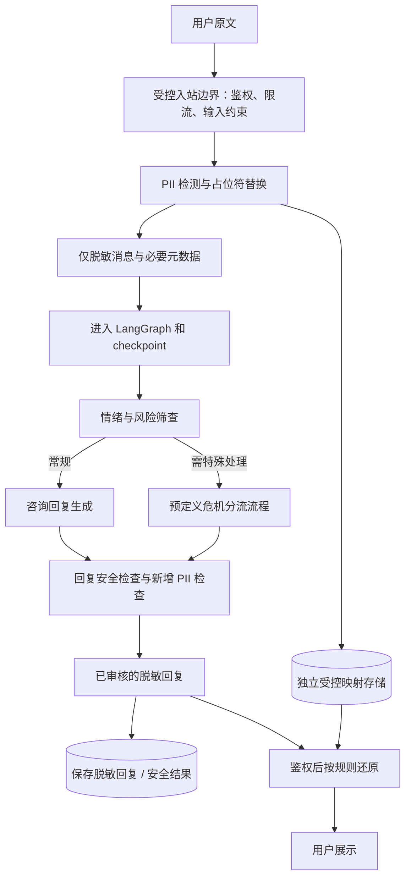

# 03：匿名咨询与 PII 接入设计

本文是基于当前源码的设计建议，**以下业务能力尚未实现**。目前匿名定义未确定，先保留两种方案；LLMShield、PIIGhost、YinShield、Microsoft Presidio 的具体资料和版本待补充，不在此阶段选定工具。

## 1. 先选定匿名的边界

| 维度 | 方案 A：免注册临时会话 | 方案 B：已有账号，模型侧脱敏 |
| --- | --- | --- |
| 用户入口 | 无需邮箱或账号，领取短期会话凭据 | 沿用已有登录体系 |
| 服务端是否知道账号 | 不建立账号关联；仍需明确 IP、设备及日志的处理 | 业务系统知道账号，需要隔离身份与咨询内容 |
| 身份模型 | 随机会话 ID 和持有者凭据，定义 TTL 与撤销 | 账号身份与随机咨询主体标识分开管理 |
| 长期记忆 | 初期建议仅保留当前会话；跨会话连续性另行定义 | 是否跨会话记忆由产品明确，使用隔离的咨询标识 |
| 历史查看 | 凭临时凭据访问；丢失后如何恢复需确认 | 登录后按权限查看 |
| 信息还原 | 仅当前授权会话，映射过期则保持占位符 | 明确终端用户、咨询师和后台各自的还原权限 |
| 主要改动 | 新增匿名凭据与会话模型、限流、TTL、清理机制 | 改造账号身份进入图、提示词和外部服务的路径 |
| 能够承诺的范围 | 免注册，尽量减少关联信息；不能据此承诺绝对不可识别 | 对模型服务商隐藏被识别的 PII；不等于对业务运营方匿名 |

方案 A 不能只删除 `Depends(get_current_session)`：当前 `Session.user_id` 是必填外键，数据模型、授权和历史访问都会受影响。可评估独立匿名会话表或可空用户关联，确定后通过 Alembic 迁移。

方案 B 可以复用更多现有账号代码，但 `username` 目前会进入提示词，真实 `user_id` 会进入图 metadata。脱敏范围必须包含这些旁路字段。

## 2. 占位符替换、还原和加密的区别

例如使用一条完全虚构的演示消息：

```text
用户输入：我叫张三，手机号是 13800000000，最近工作压力很大。
模型输入：我叫 [[PERSON:a1]]，手机号是 [[PHONE:b2]]，最近工作压力很大。
模型输出：[[PERSON:a1]]，我们可以先聊聊最近让你感到压力的事情。
授权展示：张三，我们可以先聊聊最近让你感到压力的事情。
```

这条链路包含三个不同任务：

1. **识别**：找出实体边界和类型，评估漏识别、误识别及中文场景效果。
2. **替换 / 还原**：用不含原文的 token 代替实体，通过受控映射恢复。一般称为可逆脱敏或化名化。
3. **映射加密**：如果映射需要持久化，再对映射使用经过审查的加密存储、密钥管理和访问控制。占位符字符串本身不是加密算法。

只做 hash 通常不能还原；简单 Base64 也不构成加密。即使姓名和电话被替换，学校、单位、稀有经历等组合信息仍可能具有可识别性，需要在场景数据集里评估。

## 3. 推荐的数据流



PII 处理应在任何原文进入外部模型、记忆检索、图输入或 checkpoint 之前完成。由于 LangGraph 可保存输入及节点状态，把原文交给图的第一个“脱敏节点”才替换，仍可能过晚。

FastAPI 的参数校验可能早于业务处理；当前校验异常会记录 `exc.errors()`。因此，新增一个脱敏服务调用的同时，还应收敛校验失败日志、错误响应和网关日志中的原文，避免在进图前泄露。

如果某些筛查必须使用原文，应在经确认的本地可信边界内处理，输出最少的结构化结果后进入图；不要默认把原文发给另一家筛查模型。情绪、风险等级及危机处置策略需由业务和专业负责人定义，本文不制定诊断或临床处置规则。

## 4. 在仓库里具体改哪里

以下新目录是建议位置，目前没有创建业务实现。

| 改造点 | 现有位置 / 建议新增位置 | 要达到的行为 |
| --- | --- | --- |
| 匿名身份与凭据 | `app/api/v1/auth.py`、`app/models/`、`alembic/versions/` | 按选定方案签发、验证、过期和撤销凭据 |
| 统一入站处理 | `app/api/v1/chatbot.py`，建议新增 `app/services/consultation.py` | 普通、流式及中断恢复请求都先通过相同脱敏边界 |
| PII 工具适配 | 建议新增 `app/services/privacy.py`、`app/schemas/privacy.py` | 用 Pydantic 请求/响应模型包装检测、替换和还原，便于替换工具 |
| 映射存储 | 独立存储与访问接口，是否新增表另定 | 存储授权主体、作用域、过期时间及加密映射；不放入图状态 |
| 图状态 | `app/schemas/graph.py` | 增加经定义的筛查结果、安全检查结果、策略版本；避免原文和密钥 |
| 节点与路由 | `app/core/langgraph/graph.py`，复杂节点可拆到 `nodes/` | 调整入口、`goto`、结束边，使所有回复经过检查 |
| 咨询提示词 | `app/core/prompts/` | 编写场景职责、边界和固定回复策略 |
| 模型出口 | `app/services/llm/` | 主调用与回退模型均接收脱敏内容，并限制允许使用的供应商 |
| 前端输出 | `chatbot.py`、`get_stream_response()`、`get_chat_history()` | 统一审核和还原；历史接口也走相同授权规则 |
| 评估与回归 | `evals/metrics/prompts/`、后续 `tests/` | 质量指标与确定性的授权、隔离、泄露测试分别建设 |

仅供接口讨论的数据结构：

```text
输入对象：PrivacyRequest(messages, authorized_scope)
输出对象：SanitizedConversation(messages, mapping_handle, policy_version)
还原对象：RestoreRequest(approved_text, mapping_handle, authorized_scope)
```

`authorized_scope` 必须由服务端鉴权生成，不能直接相信客户端传入的用户或会话 ID。`mapping_handle` 只是引用，不是包含原文的字典；即使只保存引用，也要判断它是否有必要进入持久化或追踪数据。

## 5. 必须一起覆盖的现有路径

| 路径 | 当前行为 | 改造要求 |
| --- | --- | --- |
| 自动标题 | 原文前 40 字落库，前 500 字参与标题模型调用 | 使用脱敏输入和标题，或在匿名场景关闭 |
| 长期记忆检索 | 使用最后一条原文作为查询 | 先脱敏；选定主体隔离方式；不要共享一个匿名 user_id |
| 长期记忆写入 | 后台传入对话及 metadata | 只保存已批准的最少数据；定义跨会话关联及占位符作用域 |
| username / user_id | 进入提示词或 metadata | 使用经策略允许的化名和随机咨询标识 |
| checkpoint | 保存传入的图状态 | 所有入图输入均脱敏，包括恢复中断时的文本 |
| 网页搜索 | 模型可生成搜索词并调用外部搜索 | 首期可不开放；开放时检查参数，并将工具结果作为不可信输入 |
| Langfuse 和应用日志 | 可记录输入、输出、标题、异常文本等 | 保留追踪能力，使用脱敏字段和受控采集策略 |
| 评估 | 从 Langfuse 取数据交给评估模型 | 将评估模型和报告纳入同一数据边界 |
| 历史和异常响应 | 历史来自 checkpoint；部分错误返回 `str(e)` | 历史按权限还原，异常使用稳定错误码，原始错误仅在受控路径处理 |

`MemoryService` 在 `user_id is None` 时会跳过检索和写入，这是可利用的现有分支；但当前路由总会传入注册用户 ID，启动时还会预热 mem0。因此它不等于已经实现了匿名模式或禁用记忆的配置开关。

## 6. 流式回复需要单独设计

当前 `astream(..., stream_mode="messages")` 直接将模型文本增量发出。完整回复生成后再运行安全节点，无法撤回已发出的内容。新增情绪或安全判定模型后，还可能把这些中间节点的文本混入流中，因为当前代码没有按节点 metadata 过滤。

建议第一阶段使用“生成完整候选回复 → 审核 → 授权还原 → 返回”的流程，先通过普通 JSON 接口验收。若仍使用 SSE，可以发送进度事件，再发送审核后的结果，但应明确这不是逐 token 实时生成。

确需低延迟逐段展示时，再设计缓冲和审核协议：处理跨 chunk 的占位符、只输出审核通过的节点、超时或拦截的结束事件，并验证敏感 token 不会先发后拦。占位符如 `[[PERSON:` 与 `a1]]` 分在两段时，逐 chunk 的字符串替换不能正确处理。

## 7. 映射与数据生命周期

- **作用域**：至少绑定授权主体和会话。不同会话的相同 token 不应查到彼此的原文；如有跨会话记忆，另外定义记忆的脱敏策略。
- **多轮一致性**：同一实体在同一会话内使用稳定映射；新增实体不覆盖旧映射，并处理并发消息、重试和中断恢复。
- **还原边界**：只还原当前授权作用域中已知且允许展示的 token，校验客户端伪造、模型新增和过期 token；异常时不猜测原文。
- **存储边界**：映射、原文和密钥不写入提示词、LangGraph state、Langfuse、普通日志或普通缓存。
- **保存期限**：明确会话、checkpoint、映射、记忆、缓存和追踪的 TTL；映射比历史提前过期时，产品应允许仅展示脱敏历史。
- **删除**：分别处理会话、checkpoint、映射、mem0、缓存和追踪，以及正在执行的后台写入任务，避免删除后又被写回。
- **故障**：PII 检测或映射服务不可用时返回可控错误或安全提示，不能回退为发送原文。

以上为匿名咨询功能的验收边界，当前模板没有完整实现。

## 8. 收到 PII 工具资料后如何选型

LLMShield、PIIGhost、YinShield 的同名项目与具体版本需以同事提供的链接确认；Microsoft Presidio 也需确定采用的组件和部署方式。先用相同的虚构中文测试集比较以下维度，再作决定：

| 维度 | 要收集的证据 |
| --- | --- |
| 中文识别 | 姓名、手机号、身份证、地址、单位、学校、混合语言及间接身份线索的漏检/误检 |
| 可逆能力 | 替换与真正的加解密分别由谁完成；映射是否跨请求、多轮稳定 |
| 部署与外部调用 | 是否能在团队认可的环境运行，检测是否还会访问外部模型 |
| 并发和延迟 | 长文本、多实体、多轮、并发会话和故障时的表现 |
| 工程与维护 | Python 3.13 / Windows 开发兼容性、许可证、版本维护及可替换性 |
| 安全与生命周期 | 隔离、授权还原、密钥管理、TTL、审计及删除方式 |

验收用例至少包含：跨会话无法还原、伪造 token 不被当作有效映射、同名不同人不串值、重试不产生冲突、PII 服务失败时不发送原文、流式跨块 token 不泄露，以及日志/追踪/记忆/搜索/标题等路径的原文检查。
