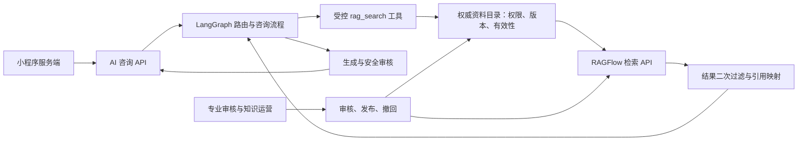

# 06：RAGFlow 检索工具与知识发布设计

更新日期：2026-11-02。本文是 AI 咨询后端的待实现设计；本地代码当前只注册了网页搜索和 `ask_human` 工具，尚未接入 RAGFlow。业务入口由小程序及其服务端承接，RAGFlow 管理台面向知识维护人员。

## 1. 技术分工和版本基线

采用“LangGraph 主编排 + RAGFlow 受控检索工具”：本工程负责鉴权、风险分流、咨询生成、输出审核、引用、会话、转人工与业务事件；RAGFlow 负责资料解析、索引和证据检索。用户消息不直接交给 RAGFlow 的聊天助手独立作答，否则会绕过本工程的风险、来源和转人工规则。

截至核验时，官方发布列表同时包含 `v0.27.3` 和 `v1.0.0-rc3` 等分支。**客户/团队尚未选定部署版本**；本文仅以固定标签 `v0.27.3` 的资料验证接口形状，不将其认定为最终生产选型。接入前锁定 tag、commit、镜像 digest、Compose 文件、API/SDK 版本及模型配置，不能用 `main`、`dev` 文档或 `latest` 镜像作为验收基线。[官方发布列表](https://github.com/infiniflow/ragflow/releases)



## 2. 已核验的检索接口

`v0.27.3` 的固定版本 HTTP 文档列出 `POST /api/v1/retrieval`，使用 Bearer API key。请求含 `question`、`dataset_ids`，可用 `document_ids` 限定资料，也提供 `metadata_condition`。返回 `data.chunks`，包含片段 `id`、`document_id`、`dataset_id`、`content`、`similarity`、`positions` 等字段；适配器需同时检查 HTTP 状态与响应体 `code`。[固定版本 HTTP API](https://github.com/infiniflow/ragflow/blob/v0.27.3/docs/references/http_api_reference.md#retrieve-chunks)

以下仅展示在该版本核验过的最小请求形状，ID 与文本均为占位值，不能直接运行：

```json
{
  "question": "<本轮检索问题>",
  "dataset_ids": ["<服务端允许的知识库ID>"],
  "document_ids": ["<已通过权限和有效性校验的文档ID>"],
  "page": 1,
  "page_size": 8,
  "highlight": false,
  "include_knowledge_compilation": false
}
```

本项目的 `rag_search` 入参建议只暴露经验证的问题文本、知识类别等业务字段。租户、资料范围、地域、查询日期、发布版本、模型和阈值由服务端上下文确定；客户端和模型不能指定任意 RAGFlow 地址、API key 或扩大可检索的资料集合。

首版示例关闭该版本的知识编译片段，先验收原始资料片段与来源的对应关系。后续如启用编译/摘要等派生内容，需建立回到原始证据的可验证链路和独立版本记录，不能将派生文本自动当成政策原文。

适配器输出是本项目定义的业务对象，**不是声称 RAGFlow 原生返回以下结构**：

```text
RetrievalResult
  status: hit | no_evidence | unavailable | invalid_response
  knowledge_version / query_id / duration_ms
  evidence[]:
    evidence_id / dataset_id / document_id / chunk_id
    excerpt / similarity / positions
    source_registry_id / source_title / official_url
    document_number / jurisdiction / effective_from / effective_until
    content_version / review_status
```

标题、官方 URL、文号、地域、生效状态等从已审核的资料目录补全，不能假定每次检索都会返回全部文档元数据。相似度是召回参考值，不是事实正确率或回答可信度。

## 3. 按三类资料建库

| 类别 | 初始内容 | 必备业务元数据 |
| --- | --- | --- |
| 戒毒康复知识 | 危害识别、成瘾机制、康复科普、家属帮教等经专业审核资料 | 专业审核人/日期、适用对象、风险类别、来源和版本 |
| 政策法规 | 国家、江西省以及客户明确的市县范围的法规政策和官方解读 | 政策名称、文号、发布机关、地域、发布日期、生效日、失效日、替代关系、官方原文 |
| 办理流程 | 预约、筛查、入所、建档、转介、救助等已确认的办理口径 | 业务编码、条件、材料、步骤、时限、适用区域、负责部门、关联功能编码和版本 |

可以使用三个 dataset，也可以按权限、地域和 embedding 兼容性进一步拆分。一次跨库检索的模型兼容性需用选定版本验证；不能为了合并召回就把所有资料放到一个无权限区分的库。第一版不自动抓取并发布互联网上的医学或法律文本，待客户提供正式材料及审核责任人。

每份资料另建业务目录记录，建议字段：`source_id`、`dataset_id`、`document_id`、`category`、`title`、`official_url`、`document_number`、`jurisdiction`、`audience`、`effective_from`、`effective_until`、`status`、`content_version`、`supersedes_source_id`、`reviewed_by`、`reviewed_at`、`published_version`、`checksum`。这些是建议的数据模型，尚无迁移或接口。

时间以明确时区的业务时点判断，约定日期边界为生效日包含、失效时点不包含。空失效日只表示暂未给定结束时间，不代表已审核有效；未提供地域或政策有效性时，不据此自动推断适用政策。

## 4. 政策有效性必须在查询时生效

向量相似度不会自动理解法规是否现行，定时下架也可能晚于失效时点。建议采用以下流程：

1. 读取当前可用的 `knowledge_version` 和服务端授权范围。
2. 从业务目录计算本次可用资料：已审核发布、未撤回、地域和对象适用，且 `effective_from <= as_of`、结束时间为空或 `as_of < effective_until`。
3. 优先使用这些资料 ID 限定检索；如采用原生 metadata 过滤，需先验证该版本的运算符、日期类型、空值及组合条件的实际行为。
4. 对返回的每个片段再次关联业务目录，校验权限、有效性和版本；缺少目录记录或版本不一致的片段不进入模型上下文。
5. 资料不足时返回 `no_evidence`，允许在预算内追加检索或澄清地域；不能放宽到失效、待审或其他租户资料来凑答案。

**空 ID 集合必须短路**：如果没有可用文档，直接返回 `no_evidence`；不能把空 `document_ids` 传给远端冒充“只检索零份文档”，因为空列表可能表示不限制文档。

`v0.27.3` 文档存在 metadata 过滤能力，但这不证明团队最终版本支持所有需要的日期和布尔表达式。若无法原生表达，先在服务端求出允许的文档集合，再限定检索并二次过滤；集合较大时按受控批次检索或发布分区，设置候选量和超时预算。仅在召回后丢弃失效结果可能损失有效召回，需要验证补召回行为；补召回仍不足就转澄清/人工。

普通查询默认解释现行政策。历史政策咨询应作为明确的专用路径，使用用户确认的历史时点并展示“历史政策”及适用时间，不与现行政策答案混用。临近失效时点或发布撤回时，最终发送前再次核验本轮证据仍可用于当前回答。

## 5. 工具调用和生成约束

- 领域知识、政策、办理流程进入确定的检索路径，不把“要不要检索”完全交给自由工具调用。多意图可有限拆分子查询，所有查询共享单轮预算。
- 先做输入安全和风险分流。急性风险优先响应已确认的应急策略，不能等待知识库超时后才处理。
- 多轮改写只补足必要的指代和场景，不把完整对话、账号资料或其他用户内容发送给检索服务。
- 检索内容属于资料，不能执行片段中夹带的指令。剔除不允许的内容，限制长度，清晰区分系统指令、用户问题和证据。
- 医学类回答添加经客户确认的科普边界提示；高危问题按风险流程处理。政策解释和个案判断分开，证据不足或超范围时引导人工。
- 流程里的跳转返回已登记的功能编码和允许参数，业务服务核验后生成卡片；模型不得拼接任意小程序路径、外部网址或办理承诺。
- 只有通过输出检查的文本和引用才可进入可见流。检索进度、耗时和失败事件不应把工具原始错误、key 或内部地址泄露给前端。

## 6. 可溯源引用

每个可见引用编号映射到本轮实际通过过滤的证据。校验回答中的引用编号、关键断言与片段内容；模型编造的资料标题、文号、URL 或未召回的引用不能进入结果。

对小程序返回的来源卡片建议包括：`citation_id`、标题、来源类型、文号（适用时）、发布机关、有效状态/时间、经审核的官方 URL、授权的资料预览标识、文档版本。页码或位置只有解析结果可信时才展示；解析不到时使用片段定位，不虚构页码。

RAGFlow 内部 `document_id` 和 `chunk_id` 由本工程保存以供审计，前端查看来源应走受控来源接口。接口按用户身份校验访问权限，返回允许的官方原文链接或受控预览；不把管理台登录地址、内网文件地址或 RAGFlow API key 交给小程序。

会话保留回答时使用的 `knowledge_version`、证据 ID 与必要来源快照，便于追溯当时依据。历史答案的快照不意味着失效政策可以继续用于新回答；再次追问时按当前查询规则重新检索。

## 7. 发布、失效下架和缓存

```text
资料接收 → 结构化元数据校验 → 解析/切块/OCR抽查
        → 专业审核 → 暂存库检索回归 → 发布版本切换
        → 监测生效/失效/撤回 → 更新可用目录与索引 → 回归与审计
```

发布版本需绑定资料目录和可用索引集合。跨系统没有天然原子事务，应定义“准备完成后切换发布指针”的过程；未完成索引或审核的文档不能因已经上传就被生产检索。

撤回和失效首先更新业务目录，使查询立即排除该资料，再执行 RAGFlow 禁用/删除或切换发布集合；远端动作失败继续重试并告警，后端过滤继续生效。政策到期必须由查询时点判断兜底，不能只依赖后台定时任务。

成功检索结果可短期缓存；key 至少包含授权范围、知识类别、地域、规范化问题、发布版本和影响有效性的时间范围。失效期短于 TTL 时缩短 TTL；撤回、发布和权限变更使相关缓存失效。读取缓存后仍做有效性与权限检查。`no_evidence`、超时和错误不写成功缓存；科普和政策缓存期限分别配置。

## 8. 超时、降级、重试与幂等

| 场景 | 本工程行为 |
| --- | --- |
| 无可用资料或过滤后不足 | 明确当前证据不足；收集必要场景信息或展示转人工入口，不据模型常识编造政策/办理条件 |
| HTTP 失败、远端业务 `code` 非成功、schema 不兼容 | 记录结构化错误分类，向工作流返回 `unavailable` 或 `invalid_response` |
| 网络抖动或受限流的只读检索 | 使用 tenacity 指数退避，并受总时限、尝试次数和取消信号约束 |
| 凭据无效、权限拒绝、参数不兼容 | 不做无条件重试，不改用公开网页搜索替代权威政策来源 |
| 用户停止生成或本轮已经失效 | 取消可取消任务，丢弃迟到结果，禁止将其混入下一轮 |
| 重试或同轮重复工具调用 | 用 `run_id + tool_call_id + request_fingerprint` 关联去重，不重复创建转介或转人工工单 |

只读检索不产生业务工单。上传、解析、发布、撤回是知识运营写操作，需要独立权限、操作编号和幂等状态，不能被咨询模型作为普通 tool 随意调用。任何涉及工单的副作用由业务服务另外处理。

建议配置单个异步 HTTP 客户端与连接池、单轮工具总预算、并发上限、最大返回片段数和正文长度。具体毫秒阈值、命中阈值及重排模型需用客户测试集测定，不在资料缺失阶段承诺准确率或吞吐。Langfuse 保留受控工具追踪和必要元数据；日志不记录 key、完整个人信息或整份资料原文。

## 9. WSL 与现有资源的部署约束

官方 `v0.27.3` README 给出的自托管基线为至少 4 核 CPU、16 GB 内存、50 GB 磁盘；这只是官方前提，不是本工程与现有容器并跑时的充足性证明。选择 Elasticsearch 路线还需核查 `vm.max_map_count`。[固定版本部署说明](https://github.com/infiniflow/ragflow/blob/v0.27.3/README.md#-self-hosting)

该版本基础 Compose 的业务元数据库使用 `mysql:8.0.40`，对象存储服务与检索引擎也单独存在；缓存/队列随 Python 或 Go 路线有 Valkey/Kvrocks 等配置差别。用户已有 `mysql:9.6.0` 和 `redis:7-alpine` **不能仅因名称相近就认定兼容**，更不能把现有业务 volume 挂进新的数据库容器。[固定版本 Compose](https://github.com/infiniflow/ragflow/blob/v0.27.3/docker/docker-compose-base.yml)

推荐的最小准备顺序：

1. 盘点正在运行的 Docker context、WSL 内存/磁盘、镜像、volume、端口和既有 conda/uv 环境；先复用当前已验证的本工程 Python 环境。
2. 确定 RAGFlow 版本和一种检索引擎，按其 Compose 解析最终服务列表及资源，不同时启动所有可选 profile。
3. 逐项判断中间件复用：兼容版本、独立数据库/用户或命名空间、访问控制、容量和备份都满足后才复用；否则只为不兼容的必需组件建立隔离实例。
4. 使用独立 Compose project、独立 volume 和无冲突端口；控制台和管理接口仅开放给开发/运营人员。已有 MySQL/Redis 业务不做就地升级或共享数据目录。
5. 完成一份测试资料的上传、解析、有效性过滤和引用联调，再扩大资料量。测试资料使用虚构数据。

RAGFlow 的元数据库、检索引擎和本工程 PostgreSQL/checkpoint 的职责不同。接入 RAGFlow 不自动消除本工程现有 PostgreSQL 依赖；也不要求立即启用 mem0 跨会话个人记忆。两者按咨询需求另行配置，避免重复保存同一类知识。

本次仅核对官方资料并整理设计，没有下载 RAGFlow 镜像、启动新中间件或创建额外虚拟环境。宿主机/WSL/容器之间的地址与端口应由实际联调确认，不能把 `localhost` 或 Compose 服务名在三种运行位置直接互换。

## 10. 第一轮验收证据

| 验收项 | 必须提供的可复现证据 |
| --- | --- |
| 固定版本 API | 版本及 digest 记录；最小检索成功、非成功 body code、权限错误、schema 校验结果 |
| 政策时效 | 现行、未来生效、刚失效、撤回、缺失元数据、替代政策和历史查询的样本；冻结时间边界测试 |
| 权限和空集合 | 不同权限范围不能召回对方资料；允许文档集合为空时不会退化为全库检索 |
| 地域和对象 | 国家/江西/市县、成年人/未成年人等材料按确认的适用规则处理，不以高相似度越过范围 |
| 来源真实性 | 每条来源都能回到本轮片段；编造引用、解析不到页码、过期链接和无预览权限均有可控行为 |
| 发布一致性 | 新版本未准备好不切换；撤回立即被业务目录拦截；缓存及在途回复不继续引用被撤资料 |
| 工具故障 | 限流、超时、取消、迟到结果、异常正文和重试预算测试，不调用任意回退数据源 |
| 业务兜底 | 证据不足符合工作流的无法作答计数和转人工策略，不因正常澄清或停止生成错误计数 |

客户尚需提供经审核知识、政策原文及有效性清单、各业务流程、地域范围、审核/发布负责人、资料访问权限、测试问答与期望引用。小程序同事需提供来源卡片/原文预览和功能跳转协议；这些协议未确认前，先使用服务端注册的功能与来源标识联调。
